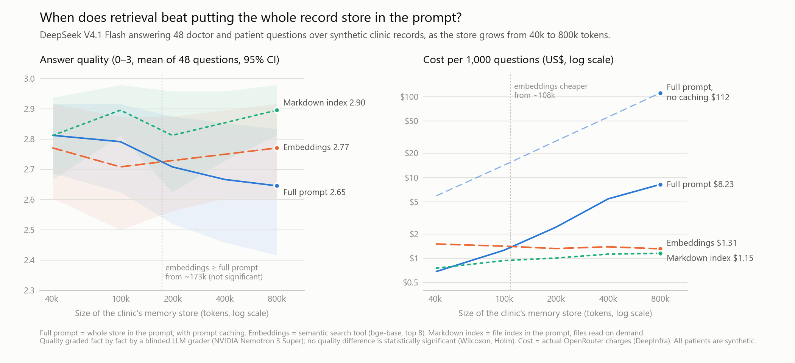

# Full prompt, embeddings or an index? A clinical memory-retrieval study

An AI assistant in a clinic has to answer questions from the clinic's stored records. You can put the
whole record store in the prompt, search it with embeddings, or give the model an index and let it open
files. This study measures, as the store grows from 40k to 800k tokens, **where each approach wins on
answer quality, tokens and cost.**

## Results

DeepSeek V4.1 Flash answered 48 doctor and patient questions about 20 synthetic patients. The store was
then padded with up to 436 synthetic filler patients from other doctors. Every answer was graded fact by
fact against a clinician-approved gold answer.

| Store size (tokens) | 40k | 100k | 200k | 400k | 800k |
|---|---|---|---|---|---|
| **Quality (0–3)**, full prompt | 2.81 | 2.79 | 2.71 | 2.67 | 2.65 |
| **Quality**, embeddings | 2.77 | 2.71 | 2.73 | 2.75 | 2.77 |
| **Quality**, markdown index | 2.81 | 2.90 | 2.81 | 2.85 | 2.90 |
| Tokens per question, full prompt | 41k | 100k | 199k | 400k | 799k |
| Tokens per question, embeddings | 11k | 11k | 10k | 11k | 11k |
| Tokens per question, markdown index | 6k | 9k | 13k | 22k | 40k |
| Cost per 1,000 questions, full prompt (cached) | $0.69 | $1.26 | $2.42 | $5.45 | $8.23 |
| Cost per 1,000 questions, full prompt (no cache) | $5.95 | $14.20 | $28.28 | $56.30 | $112.11 |
| Cost per 1,000 questions, embeddings | $1.50 | $1.41 | $1.32 | $1.39 | $1.31 |
| Cost per 1,000 questions, markdown index | $0.76 | $0.94 | $1.01 | $1.13 | $1.15 |

**What it shows**

- **Quality barely moved, and not significantly.** The full prompt slides from 2.81 to 2.65 as the store
  grows; embeddings and the markdown index stay flat. The embeddings line crosses the full-prompt line at
  about 173k tokens (95% CI 45k–399k), but no difference at any size survives correction for multiple
  comparisons (Wilcoxon signed-rank, Holm). DeepSeek handled an 800k-token prompt well on lookups.
- **The slide is in composing, not looking up.** Drafting a clinic note from scattered records fell from
  2.50 to 0.75 out of 3 with the full prompt at 800k (4 questions per task, descriptive only). Lookups,
  medication reconciliation and lab trends stayed near 3.0 at every size.
- **Cost is where the methods separate.** With prompt caching, the full prompt is cheapest at 40k. Embeddings
  become cheaper at about **108k tokens**, and the markdown index at about **47k**. Without caching, both are
  cheaper at every size, and the full prompt costs $112 per 1,000 questions at 800k.
- **The simplest method did best.** An index file in the prompt plus files opened on demand, the pattern
  coding agents such as Claude Code use for memory, had the highest quality at every size and became the
  cheapest from about 47k tokens. Clinical records are already organised by patient, so an index of patient
  files points the model at the right record.
- **Embeddings struggle with cohort questions.** "Which of my diabetic patients…" needs every matching
  patient, and top-8 search scored 2.0–2.75 on those questions against 2.25–3.0 for the other two methods.
- **Safety.** No safety-critical misses in any of the three methods. Two answers mixed in another patient's
  details, both from the full prompt at 400k and 800k; none from embeddings or the index.
- **Memory is needed at all.** With no memory the model scored 0.15 and missed 6 safety-critical facts.

The whole study, including the pilot and every check, cost **$1.77** in API charges.

## What was tested

| Method | What the model gets |
|---|---|
| **Full prompt** | The whole store in the system prompt, with the provider's automatic prompt caching |
| **Embeddings** | A `search_memory(query, k=8, patient_id?)` tool over local `BAAI/bge-base-en-v1.5` vectors, exact cosine search |
| **Markdown index** | An index of record files in the prompt, plus `read_file` and `grep` tools |
| Gold records only (check) | Only the records each question's answer comes from |
| No memory (check) | Nothing |

- **Records:** 20 synthetic patients and 2 doctors, 316 records over 18 months, with planted traps: two
  patients named R. Sharma, superseded doses, a rescheduled appointment, a brand-name allergy. Filler
  patients for doctors outside the questions grow the store to five sizes. Every record appears exactly
  once, with identical text, in every method's view.
- **Questions:** 48 across 12 tasks (pre-visit summaries, prescribing safety checks, cohort questions, note
  drafting, lay-language recall, open referrals and others), 7 of them unanswerable from the records. Each
  has a clinician-approved gold answer, required facts, forbidden statements and safety flags.
- **Model under test:** `deepseek/deepseek-v4.1-flash` (open weights) via OpenRouter, pinned to DeepInfra
  (fp8), temperature 0, reasoning effort medium, at most 8 tool calls per question. One run per question,
  method and store size.
- **Grader:** `nvidia/nemotron-3-super-120b-a12b` (open weights, a different model family), blinded to the
  method, grading each required fact against the full patient records. Before the main run it gave all 48
  gold answers full marks.

The design was pre-registered in [DESIGN.md](DESIGN.md) before any data was collected. Every later change,
including the ones made after the pilot and one after the main run, is dated and explained in its
deviations log.

## Limitations

- **One model.** Other models degrade differently with long prompts; the crossover points are for
  DeepSeek V4.1 Flash on this task.
- **Synthetic records.** Written by language models (Claude Haiku for the core, Nemotron 3 Super for the
  fillers) and reviewed by a clinician. Real records are messier.
- **An LLM grader, not yet checked against a human.** The grader gave all 48 gold answers full marks, and
  its pilot grades were read answer by answer, which found two rubric problems that were fixed before the
  main run. The planned blind clinician re-grade of a 20% sample (Cohen's κ) has not been done; the tooling
  for it is in `src/judge.py` (`--sample-for-human`, `--kappa`).
- **Small differences, near the ceiling.** 48 questions, scores mostly between 2.6 and 2.9 out of 3. The
  study can rule out large quality gaps, not small ones.
- **The gold-records-only check is not a true ceiling.** It scored 2.67, below the full prompt at 40k,
  because some questions' lists of source records leave out context the answer needs (for unanswerable
  questions, the list is empty). The three methods' scores don't depend on those lists.

## Reproduce it

Python 3.10+ (`pip install -r requirements.txt`), an OpenRouter API key in `OPENROUTER_API_KEY`, and about $2 of credit (at least $10 bought
in total, which lifts OpenRouter's daily limit on its free models). [RUNBOOK.md](RUNBOOK.md) lists every
step with its cost; the offline tests run with `python -m pytest -q`.

| Path | What it holds |
|---|---|
| `DESIGN.md` | Pre-registration, hypotheses and the deviations log |
| `SPEC.md` | Data formats and module contracts |
| `world/` | Synthetic patients (`core/`) and filler patients (`distractors/`), store sizes in `levels.json` |
| `questions/` | The 48 questions, gold answers and the record of how facts were aligned |
| `src/` | Rendering, retrieval tools, the agent loop, grader, pricing and analysis |
| `results/` | Per-run and summary tables, crossovers, tests, per-task quality |
| `docs/` | The headline chart (`python -m src.plot_headline`) |

All patients, doctors and records are fictional. Nothing here is medical advice or evidence that any of
these methods is safe for real patients.
